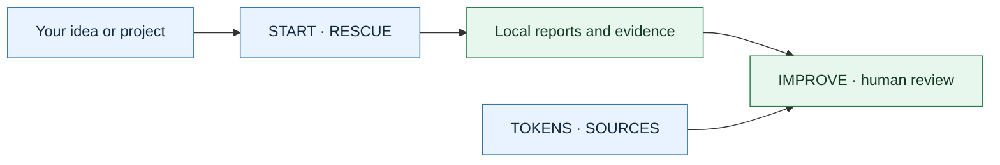

# Vibe Coding Reference

**A local-first toolkit for people building with coding agents.**
Scope ideas, inspect projects and review improvements with evidence and human oversight.

[](https://github.com/MaximeFARRE/vibe-coding-reference/actions/workflows/ci.yml) [](pyproject.toml) [](LICENSE) [](docs/IMPLEMENTATION_STATUS.md)

[Quick start](#quick-start) · [Français](README.fr.md) · [Contributing](CONTRIBUTING.md) · [Research](research/README.md) · [Security](SECURITY.md)

> **Prototype.** Reports are partial and require human review. VCR does not guarantee a project is safe or bug-free. It runs locally, uses no API key, and does not create another agent or model.

## What can I do with VCR?

| Workflow | Purpose | Output / boundary |
|---|---|---|
| **START** | Turn an idea into a project brief | Criteria and stack options for human review |
| **RESCUE** | Inspect a project passively | Evidence and limits; no target modification |
| **CHECK** | Run a short, passive project checklist | Structured evidence and clear limits; no project commands |
| **IMPROVE** | Review selected reports or notes | Supervised proposals; no changes applied |
| **TOKENS** | Examine context or an explicitly supplied trace | Descriptive diagnosis; no inferred subscription quota or savings |
| **SOURCES** | Browse references and tools | Local catalog; no automatic installation |



## Quick start

On macOS or Linux, with Git and Python 3.11+:

```sh
git clone https://github.com/MaximeFARRE/vibe-coding-reference.git
cd vibe-coding-reference
export PYTHONPATH="$PWD/src"
python3 -m vcr --help
python3 -m vcr
```

Try RESCUE and IMPROVE on a [fictional project](#try-a-fictional-project). Reports and the interactive interface are in French. Windows and editable installation have not been verified. VCR does not contact a service during use; cloning requires a network connection. Native Codex and Claude Code session logs are not currently supported by TOKENS.

[](README.fr.md)


### Try a fictional project

On macOS or Linux, after setting `PYTHONPATH` as above:

```sh
VCR_DEMO_DIR="$(mktemp -d)"
mkdir "$VCR_DEMO_DIR/projet"
printf '{"dependencies":{"next":"fixture"}}\n' > "$VCR_DEMO_DIR/projet/package.json"
python3 -m vcr rescue --repo "$VCR_DEMO_DIR/projet" --out "$VCR_DEMO_DIR/rapport-1"
python3 -m vcr rescue --repo "$VCR_DEMO_DIR/projet" --out "$VCR_DEMO_DIR/rapport-2"
python3 -m vcr improve --project "$VCR_DEMO_DIR/projet" --from "$VCR_DEMO_DIR/rapport-1/run.json" --from "$VCR_DEMO_DIR/rapport-2/run.json" --out "$VCR_DEMO_DIR/ameliorations"
python3 -m vcr tokens
python3 -m vcr sources --topic tokens
printf 'Local reports: %s\n' "$VCR_DEMO_DIR"
```

Open `rapport-1/report.md`, then `ameliorations/report.md`, in the displayed directory. The project and reports are fictional; the temporary directory remains until you delete it. To try START, run `python3 -m vcr start --interactive --out "$VCR_DEMO_DIR/cadrage"` and answer using fictional data.

For an existing project, use `python3 -m vcr rescue --repo "/path/to/project" --out "/path/to/new-report"`. Output directories must be new; for RESCUE and IMPROVE they must also be outside the project and must not contain it. On Windows PowerShell, replace the export with `$env:PYTHONPATH = "$PWD/src"` and use `python` if needed; **Windows has not been verified**.

### Install or uninstall the package

Running without installation, as above, is the shortest route. To install in a dedicated virtual environment on macOS/Linux: run `python3 -m venv .venv`, then `. .venv/bin/activate` and `python -m pip install .`. Package preparation may download Python build tools. Installation and uninstallation were verified in a temporary macOS/Python 3.12 environment; editable installation and Windows remain unverified. Once installed, `vcr --help` works in the activated environment.

To uninstall, activate the same environment and run `python -m pip uninstall vibe-coding-reference`. You may delete the virtual environment if it is dedicated to VCR; reports created elsewhere must be deleted separately if desired. Without installation, deleting the VCR directory and its separate reports is sufficient.

## Scope an idea with START

The questionnaire asks about the need, an action and its visible result, users, data and constraints. An empty answer means “to be determined”. It produces a brief, criteria for review, stack options and a Codex prompt, as well as `answers.json` to resume later. It creates no infrastructure or accounts.

To resume in a **new** directory:

```sh
python3 -m vcr start --interactive --from "/path/to/brief/answers.json" --out "/path/to/new-brief"
```

Saved answers, including “to be determined”, are not requested again. To change them, start over without `--from`. The documents contain your answers in plain text: do not enter secrets or personal data, and review them before sharing. Stack options and criteria remain assumptions for the owner to validate; they do not replace a security or feasibility assessment.

## Run a project health check

```sh
python3 -m vcr check --repo /path/to/project
python3 -m vcr check --repo /path/to/project --json
python3 -m vcr check --repo /path/to/project --full --format json --out /path/outside/project/check.json
```

`--repo` defaults to the current directory. Output goes to the terminal unless `--out` specifies a new file outside the project. The JSON and text describe the same results. `--full` identifies known scripts without running them; running project commands is not supported. Exit codes are 0 when no check has a confirmed failure, 1 when a potentially sensitive `.env` name is tracked by Git, and 2 on an error. Exit code 0 does not establish that the project is secure or working.

The checks use local, deterministic rules, not an AI model or network service. They inspect a bounded, filtered inventory and limited Git metadata. They identify some Git, README, manifest, lockfile, CI, agent instruction, environment example and script configuration names; they do not evaluate their quality or effectiveness. Files ignored by Git, symbolic links and large files are excluded. No project scripts run, and `.env` contents and project commands are not copied. Missing or ambiguous evidence is `not_checked`; `skipped` means a discovered execution was not performed. `passed` applies only to the stated observation, not the project's overall health.

Results include a reason and, where available, evidence, method, applicability and limitations. Internal checks validate produced fields and evidence before output, but do not implement full JSON Schema validation. Dependency vulnerabilities and backup restoration are not checked. See the [implementation status](docs/IMPLEMENTATION_STATUS.md) for the exact scope.

## Inspect a project with RESCUE

The `--out` directory must be new, outside the project, and must not contain it. Open `report.md`; `run.json` contains the same structured findings, and `ASK_CODEX_TO_REVIEW.md` is an optional review prompt.

Each finding includes evidence, confidence, two options and a review instruction to copy. To record a decision, use the finding identifier shown in the report:

```sh
python3 -m vcr feedback --report "/path/to/new-report" --finding tests-unknown --decision deferred
```

Decisions are `accepted`, `rejected`, `false_positive` and `deferred`. The latest choice for each finding is stored in `feedback.json` beside the report, without modifying the inspected project or applying a fix. Links to ordinary files are local; sensitive files are displayed without clickable links.

## Review improvements with IMPROVE

Explicitly select reports from the **same project** and a new output directory outside it:

```sh
python3 -m vcr improve --project "/path/to/project" --from "/path/to/report-1/run.json" --from "/path/to/report-2/run.json" --out "/path/to/new-improve"
```

The report distinguishes a single observation from two observations of the same rule. Two reports may describe the same state: they do not prove two incidents or a common cause. Statuses and evidence come from the sources and require review. RESCUE findings marked `false_positive` or `rejected` in `feedback.json` are ignored. `report.md`, `proposals.json` and `registry.json` remain in the output directory. No changes are applied.

To record a decision and reuse the registry later:

```sh
python3 -m vcr improve-feedback --registry "/path/to/new-improve/registry.json" --proposal tests-unknown --decision false_positive
python3 -m vcr improve --project "/path/to/project" --registry "/path/to/new-improve/registry.json" --from "/path/to/report-3/run.json" --out "/path/to/next-improve"
```

Decisions are `accepted`, `rejected`, `deferred`, `false_positive` and `obsolete`. The decision changes only the selected registry; to refresh the Markdown and proposals, run `improve` again with the registry and a new directory. When a report is reimported, its current feedback may remove a rejected observation from the registry; reports not reimported are not automatically rechecked. Source paths appear in the outputs: review them before sharing.

The repeatable `--note` and `--log` options import voluntarily selected text files. Free text is neither interpreted nor copied. To explicitly declare an observation, place a line such as `VCR_OBSERVATION test-failure confirmed` or `VCR_OBSERVATION agents-conflict suspected` on its own; these statuses are user declarations, not automatic checks. Recognized rules: `tests-unknown`, `test-failure`, `architecture-doc`, `git-dirty`, `env-present`, `agents-conflict`, `navigation-difficulty`, `large-tool-output`, `convention-conflict`, `unused-plugin`. A copied note counts only once. Do not import private histories without an explicit choice; files are limited to 1 MiB and direct symbolic links are refused.

## Examine context with TOKENS

Without a file, the diagnosis displays a checklist and suggestions without claiming to measure consumption:

```sh
python3 -m vcr tokens
```

To voluntarily import a trace and create a report outside the project:

```sh
python3 -m vcr tokens --from "/path/to/trace.json" --out "/path/to/new-diagnosis" --project "/path/to/project"
```

`--out` is optional; without it, the result is displayed in the terminal. If a project is involved, `--project` protects its directory from output. Without it, choose a directory outside the project yourself. Outputs may include `tokens.json`, `report.md` and a review prompt. Imports accept the [documented VCR format](docs/TOKEN_TRACE_FORMAT.md) and, with `--format openai-responses` or `--format anthropic-messages`, the `usage` object of a selected individual API response. Native Codex and Claude Code session logs are not automatically recognized. Measurements are retained, but model, tool and session names, fingerprints and raw content are not copied; keep the selected trace to retrieve numerical references.

Counters are declared, not independently verified. Missing fields remain `unavailable`; declared costs are neither calculated savings nor a subscription quota. There is no history monitoring, fixed pricing or network access.

## Browse SOURCES

```sh
python3 -m vcr sources --topic tokens
python3 -m vcr sources --topic navigation
python3 -m vcr sources
```

The filter matches an exact topic; an unknown topic lists those available. Entries distinguish adoption level A/B/C, evidence status and link status. Official links, several licenses and GitHub activity metadata were checked on November 14, 2026; this proves neither effectiveness nor security. Check versions, compatibility and removal procedures before use. An `unverified` status is not a recommendation. VCR itself does not open links or install anything.

The [source policy](docs/SOURCE_POLICY.md) explains how to record versions, evidence and limits. For a security concern, consult the [security policy](SECURITY.md) before publishing anything. The [agent research notes](research/README.md) preserve observations, sources, decisions and uncertainties.

## What RESCUE examines

A limited inventory, directory filters, Git ignore rules when Git works, Git status and HEAD, common manifests, hints of test/lint/build scripts, architecture documentation names and non-excluded `.env` files. Manifest commands and values are not copied. `.env` files are never read; their presence does not establish that a secret exists. Ignored files are not inspected. Dependencies are partially counted, without vulnerability analysis.

A `confirmed` finding is an observed fact; `suspected` requires verification. `not_checked` means a check was not established; `not_applicable` means it does not apply. No alert does not prove security or correct operation. The verdict remains inconclusive. The inspection covers neither business behavior nor execution. Target directory names and paths, the Git hash and observations appear in reports: review them before sharing. Do not copy sensitive data into an agent without examining it.

Produced fields and enumerations are checked before rendering; evidence without a valid location triggers a warning and reduced confidence. This internal validation does not replace a complete JSON Schema validator. Automatic priority sorting and HTML reports are not provided.

The inventory excludes symbolic links and files larger than 1 MiB, and is limited to 10,000 files. A repository modified simultaneously may change during inspection: do not audit a tree actively controlled by a hostile third party. Read errors and unavailable Git rules are reported. Ignore rules are not evaluated outside Git; multiple manifests are identified without complete monorepo interpretation.

## Local tests

```sh
PYTHONDONTWRITEBYTECODE=1 PYTHONPATH=src python3 -m unittest discover -s tests -v
```

Tests create artificial temporary projects and require neither network access nor private data. `pytest` is offered as an optional development dependency, but is not required for this command. See the [implementation status](docs/IMPLEMENTATION_STATUS.md) for coverage and limitations.

## License

This project is distributed under the [MIT License](LICENSE).
