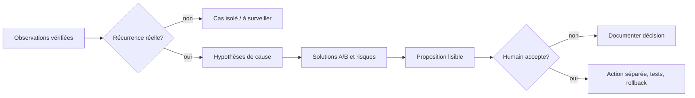

# 06 — Playbooks opérationnels pour START, RESCUE, IMPROVE et TOKENS

Ces procédures sont à implémenter dans le prototype, puis à exposer sous forme de **prompts copiable-collable** et de commandes simples. Elles n'exigent ni qu'un débutant connaisse l'architecture du dépôt, ni que VCR devienne un agent autonome.

## 1. START — questions en français ordinaire

**Objectif :** passer d'une idée d'application à un document de besoin fiable et une recommandation de départ raisonnable.

**Questions minimales** :

1. Qu'est-ce que l'application doit permettre de faire ? Quel est son parcours principal ?
2. Qui va l'utiliser : toi seul, petite équipe, clients sur internet ?
3. Où devra-t-elle fonctionner : local, entreprise, site web public ?
4. Quelles données doit-elle mémoriser ? Y a-t-il des informations confidentielles ?
5. Faut-il une interface élaborée, beaucoup de formulaires, de calculs Python, ou du référencement Google ?
6. As-tu des contraintes d'hébergement, de budget, de performance, d'intégration à d'autres services ?

**Ne demander les autres détails que s'ils changent un choix réel.** En cas de réponse manquante, faire une hypothèse explicitée et réversible, sans bloquer l'utilisateur inutilement.

**Sorties souhaitées** :

```markdown
# Besoin métier
- Utilisateurs, objectif, parcours principaux, données.
- Fonctionnalités IN / OUT.
- Contraintes non négociables.
- Hypothèses à confirmer.

# Stack proposée
- Recommandation conditionnelle ; pourquoi.
- Option plus simple si elle existe.
- Coût d'exploitation et niveau de maintenance attendus (qualitatif).
- Dépendances à NE PAS ajouter au démarrage.

# Critères de réussite
- Étant donné [situation], quand [action], alors [résultat observé].
- Que faire en cas d'erreur, absence de réseau, doublon ou permissions insuffisantes ?
- Comment vérifier sans expertise en code ?
```

**Exemples de décisions (indicatives)** :

- Site vitrine statique simple + SEO → HTML/Astro possibles ; pas de BDD/API par défaut.
- App web full-stack avec tableaux et comptes → Next.js/TS, SvelteKit, Django/HTMX ou Rails selon l'écosystème, équipe et coût opérationnel ; pas de vainqueur universel.
- Calculs et imports Python au cœur du métier → Django/HTMX ou FastAPI + frontend seulement si interactions le justifient.
- Utilitaire local mono-utilisateur → script + UI simple/Streamlit selon métier ; pas de cluster.

## 2. RESCUE — procédure d'audit détaillée

### Prévol

- Vérifier que le chemin correspond au bon dépôt ; afficher la racine Git ; capturer HEAD/branche si disponibles ; préserver modifications non commitées.
- Inventorier fichiers et stack avec filtres explicites ; relever limitations.
- Demander la permission **avant** tests, build, migrations, installations, commandes non passives ou connexions à un compte.
- Définir le périmètre : tout, sécurité, architecture, fiabilité, données, contexte, tokens, etc.

### Les 10 axes (depuis v0.1/v0.2, maintenus)

| Axe | Chercher | Pièges à éviter |
|---|---|---|
| Produit / UX | parcours métier, redondances, états d'erreur | supprimer sans comprendre le besoin |
| Architecture | flux, modules-centres, imports, frontière API | gros fichier ≠ mauvais code |
| Code | duplication réelle, fonctions mortes confirmées, complexité | imports dynamiques, reflection, feature flags |
| Dépendances | lockfile, audit vulnérabilités, versions | « dépendance vieille » ≠ exploitable |
| Sécurité | secrets, droits, origines, validations, uploads | révéler secrets ou inventer exploitabilité |
| Tests/fiabilité | tests critiques, assertion, intégration, erreurs | tests verts ≠ absence de bug |
| Données/migrations | schéma, transactions, sauvegarde/restauration | toucher données réelles, migration sur lecture |
| Performances | N+1, I/O répétés, parcours coûteux | chiffres de latence non mesurés |
| Infrastructure | démarrage, CI, déploiement, rollback | imposer Docker/Postgres arbitrairement |
| Documentation/IA | AGENTS, navigation, index, drift, coûts de contexte | générer des kilomètres de documentation |

### Distinguer trois couches de preuve

1. **Certain** : `package.json` indique tel script ; `git status` indique des modifications ; une route HTTP contient tel code à telle ligne ; une commande a vraiment échoué.
2. **Interprétation forte** : l'absence probable d'un test adapté ; un module concentrant plusieurs responsabilités ; une frontière non respectée.
3. **Question ouverte** : une fonctionnalité semble obsolète, mais il manque la mesure d'usage ; un fichier paraît inutile mais peut être chargé dynamiquement.

### Verdicts

- **KEEP** : fondations saines, quelques corrections utiles.
- **REFACTOR** : même stack et produit, changements ciblés et vérifiables.
- **PARTIAL REBUILD** : reconstruire une sous-zone avec migration/risque limité, comportement figé par tests.
- **REBUILD** : seulement si l'existant est structurellement inadapté, la réparation plus risquée/coûteuse, données/fonctions migrables et justificatif solide.
- **INCONCLUSIVE** : manque de contexte ou de vérifications, verdict reporté.

### Fiche type d'un finding

```markdown
### P1 — Validation insuffisante dans une route sensible (EXEMPLE)
État : suspecté, à confirmer sur source précise
Preuve : fichier/route/ligne, commande ou extrait REDIGÉ
Pourquoi : risque de modification sans entrée valide
Impact : intégrité / permission / expérience utilisateur
Proposition A : validation runtime à la frontière HTTP + refus clair
Proposition B : validation du service interne + route minimale
À préserver : compatibilité des clients existants et métier
Vérification : tests de route autorisé/refusé + non-régression
Risque de la correction : changement de comportements attendus
Décision humaine : valider contrat API avant modification
```

### Suite de RESCUE

1. L'utilisateur examine les 3 à 5 problèmes à plus fort impact, pas 200 alertes brutes.
2. Sélectionne un problème ; l'outil génère un ordre de travail pour Codex.
3. Codex **confirme la preuve et la viabilité** de la solution dans le projet avant de modifier.
4. Branche/commit/sauvegardes et tests de référence ; changement limité à une zone ; vérification ; rapport ; possibilité de retour arrière.
5. Aucun projet ne peut être « entièrement sécurisé » sur la base d'un audit statique rapide. Toujours noter ce qui n'a pas été vérifié.

## 3. IMPROVE — feedback supervisé du harness

**Principes** : un problème **observé et répétitif** peut motiver une amélioration des règles, des docs, de l'architecture, de la recherche ou des contrôles. L'objectif n'est pas de modifier le harness chaque jour, mais de réduire les échecs répétés.

### Sources admissibles

- Rapports RESCUE vérifiables.
- Résultats de lint/tests/CI remis volontairement par l'utilisateur.
- Notes de passation courtes d'agents antérieurs.
- Export de sessions uniquement sur **opt-in explicite**, avec filtre secrets et données privées.

### Pipeline minimal



### Exemples de propositions IMPROVE

**Exemple 1 — l'agent relit la même architecture à chaque ticket.** Preuve : sorties de sessions importées + fichiers concernés. Solution : carte de fonctionnalités de 30 lignes pointant vers modules et tests, pas RAG systématique. Mesure utilisateur : modifications plus faciles à localiser ; pas de promesse chiffrée.

**Exemple 2 — règles d'AGENTS trompeuses.** Preuve : instruction qui ordonne d'exécuter tous les tests à chaque micro-changement ; logs de commandes énormes. Solutions : tests ciblés d'abord, suite complète avant livraison ; supprimer règle obsolète. Risque : tests trop peu exécutés ; conserver garde-fous critiques.

**Exemple 3 — agent propose suppression d'un calcul métier complexe.** Preuve : fonctions imbriquées, tests partiels. Solution : tests de référence et carte de dépendances avant tout refactor ; ne pas supprimer ce qu'on ne sait pas qualifier.

**Exemple 4 — changements de contexte coûteux.** Preuve : même session mélange plusieurs sujets non liés. Solution : note de passation courte, nouvelle session ; ne pas casser un long workflow qui dépend réellement d'un état partagé.

**Exemple 5 — une migration SQLite est rappelée lors de lectures.** Preuve : chemins d'appel et usages de la routine. Solution : isoler les migrations versionnées au démarrage/maintenance après sauvegarde ; évaluer les risques de concurrence et de données. Ne pas modifier à l'aveugle.

## 4. TOKEN EFFICIENCY — ne pas confondre les métriques

### Ce que chaque rapport doit annoncer

```text
volume_total_tokens      = input + output selon le schéma disponible
cached_input_tokens      = sous-ensemble d'input si fourni
uncached_input_tokens    = input - cached_input (si défini et cohérent)
api_cost_actual          = montant fourni par une source de facturation fiable
subscription_quota       = NOT AVAILABLE sauf API/documentation officielle explicite
success_per_cost         = NON CALCULABLE sans jugement fiable du résultat
```

Il faut éviter les déductions erronées : input cached peut représenter beaucoup de trafic et être facturé à un taux réduit ; les quotas d'une application ne suivent pas forcément les tarifs de l'API. Le nombre de tokens de raisonnement peut faire partie de la sortie et il ne faut **pas le doubler** si déjà inclus.

### Leviers prioritaires sur gros dépôts

**A. Navigation ciblée** — repo map/symboles et recherche de fichiers pertinents avant lecture massive ; ne jamais limiter le contexte au point de manquer les dépendances nécessaires.

**B. Sessions cohérentes** — nouveau contexte par problème distinct ; état de passation court ; ne pas reset en plein workflow sans préserver les décisions importantes.

**C. Sorties d'outils compactes et sûres** — résultats globaux, chemins, extraits d'erreurs ; logs complets conservés localement. Ne pas compresser à l'aveugle les anchors de patchs ni les exceptions importantes.

**D. Outils/plugins proportionnés** — inventorier les MCP réellement nécessaires et réduire les descriptions injectées sans perte fonctionnelle.

**E. Boucles d'échec** — après des erreurs identiques et rapprochées, changer d'hypothèse, examiner le contrat ou demander intervention ; éviter un « retry forever ».

**F. Tests étagés** — vérification ciblée puis test complet lorsque la surface de changement le requiert.

### Diagnostic sans logs

Avec seulement un dépôt source, classer les risques de surconsommation comme **hypothèses**. Par exemple : une énorme sortie de test **pourrait** charger le contexte ; un AGENTS.md de plusieurs centaines de lignes **pourrait** imposer du travail inutile ; les tokens réels restent inconnus.

### Intégrations optionnelles

- TokenEconomizer : voir `docs/05_PROJETS_EXTERNES_ET_SKILLS.md` ; hooks à auditer.
- Codebase Memory MCP/Serena/RepoMap : recherche ciblée, besoin justifié ; ne pas leur attribuer sans étude une économie chiffrée.
- Cache API : documenter les préfixes stables ; ne pas dériver les quotas des abonnements.
- Compression résumée : expérimentale, car l'étude *Token Reduction Is Not Cost Reduction* signale des échecs et coûts accrus possibles.

## 5. RESEARCH / CATALOGUE — quel parcours pour choisir un skill ?

1. L'utilisateur décrit une tâche (ex. tests API FastAPI, debugging Next.js, interface React).
2. VCR filtre **un nombre réduit** de skills existants avec mainteneur, périmètre, version, licence, et niveau de preuve.
3. Par défaut, **recommandation sans installation** : l'utilisateur peut consulter le skill.
4. Si installation demandée ultérieurement : prévisualiser fichiers, scripts et permissions, conflit avec skills déjà installés, choix global/projet, origine, validation humaine, commandes de désinstallation.
5. Éviter toute activation cachée ou chargement complet du catalogue à chaque session.

**Cas difficile :** un skill « prouvé utile » en environnement Go et Java ne doit pas être recommandé pour un projet Python faute d'applicabilité, même si son benchmark est positif.

## 6. Rapports : deux niveaux de lecture

### Résumé pour débutant (première page)

